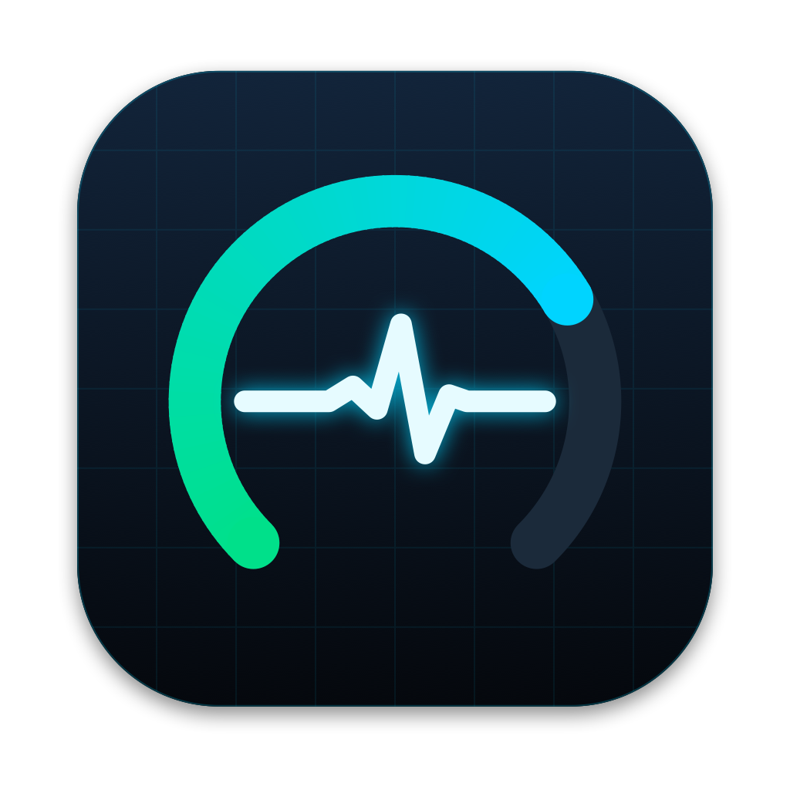

<p align="center"></p>

# Telemetría

Monitor del sistema para macOS, nativo: cifras en vivo en la barra de menú y
un panel con el detalle de cada parte del equipo. **Sin servidor, sin sudo y
sin dependencias**: solo las Command Line Tools para compilarlo.

Hasta la versión 1, este repositorio era un servidor Python con un panel en
el navegador; esa versión sigue disponible en la etiqueta
[`v1-python`](https://github.com/juanlumanmx29/mac-monitor/tree/v1-python).
La versión nativa lee lo mismo y algo más, sin pedir la contraseña de
administrador, y gasta una fracción.

## Uso

- **Barra de menú**: un icono con la CPU y la temperatura de la CPU (se puede
  elegir qué mostrar: memoria, consumo, red). Si hay alertas aparece un punto
  ámbar o rojo con su número.
- **Clic en el icono**: desplegable con seis cifras y su último minuto, y las
  alertas activas. **Clic derecho**: qué mostrar en la barra, notificaciones,
  salir.
- **Panel** (desde el desplegable, o abriendo la app): barra lateral con el
  valor vivo de cada módulo y, a la derecha, el resumen en tarjetas o el
  detalle del módulo elegido. Cerrar la ventana no cierra la app: sigue en la
  barra de menú.

| Módulo | Detalle |
|---|---|
| **CPU** | Carga y frecuencia de cada núcleo, por cluster (eficiencia y rendimiento), carga media, potencia, historial de 5 min, procesos con más CPU |
| **GPU** | Uso, renderizador, teselador, memoria, frecuencia media, tiempo por estado de frecuencia, potencia |
| **Memoria** | Apps, anclada, comprimida y caché; swap; presión real del kernel; procesos con más memoria |
| **Térmico** | Hasta 8 familias de termistores del SMC (núcleos P y E, GPU, reguladores, chasis, batería, SSD, entrada de aire) y presión térmica |
| **Ventiladores** | RPM reales con la hélice girando a su velocidad, rango |
| **Consumo** | Vatios del equipo completo (medidos en la batería o el cargador), de CPU, GPU, Neural Engine y DRAM; frecuencias de cada cluster |
| **Batería** | Carga, flujo, cargador, ciclos, salud, temperatura |
| **Red** y **Disco** | Caudal con historial; tráfico por interfaz |
| **Procesos** | Todos los procesos en una tabla ordenable, con búsqueda, filtros y ficha de cada uno |
| **Energía** | Impacto energético por proceso, la columna Energía del Monitor de Actividad |
| **Puertos** | Servicios en escucha, qué es cada uno, si es local o está expuesto a la red |
| **Reposo** | Quién impide que el equipo duerma y desde cuándo |
| **Vigilancia** | Procesos olvidados, desbocados, zombis y suspendidos |

Todos los gráficos de detalle cubren 5 minutos y muestran el valor exacto al
pasar el cursor.

### Procesos

- **Doble clic** en un proceso trae al frente la ventana de la app de la que
  depende: un `node` de la terminal integrada lleva a VS Code, un
  `WebContent` a Safari.
- **Clic derecho**: ir a su ventana, terminarlo (SIGTERM) o forzar su cierre
  (SIGKILL), siempre con confirmación; verlo en Finder; copiar su comando.
  Los procesos de otros usuarios no se pueden terminar sin privilegios: se
  ofrece copiar el `sudo kill`.
- **Clic** en un proceso abre su ficha: comando completo, cadena de padres
  (cada uno se puede abrir), puertos en los que escucha y alertas.

### Vigilancia

Revisa la tabla de procesos cada 5 s, también con la ventana cerrada. Nació de
un caso real: una shell que quedó viva al cerrar una ventana de Terminal pasó
dos días consumiendo dos núcleos sin que nadie lo viera.

| Regla | Nivel | Cuándo |
|---|---|---|
| **Olvidado** | aviso | Proceso tuyo sin ventana de terminal (ni él ni sus padres) que no mantiene ninguna app ni launchd. Lo más probable es que se cerró la ventana que lo lanzó. |
| **Olvidado, consumiendo CPU** | crítico | Lo mismo, con 20 % de un núcleo o más durante 2 min. |
| **Desbocado** | aviso | Cualquier proceso con 90 % de un núcleo durante 10 min. |
| **Zombi** | aviso | Terminó, pero su padre no lo recogió. Se agrupan por padre. |
| **Suspendido** | info | Detenido con Ctrl+Z o SIGSTOP más de 10 min. |
| **Reposo** | aviso | Algo impide dormir más de 30 min funcionando con batería. |

Lo crítico llega además como **notificación del sistema**, una vez por
proceso; al pulsarla se abre la Vigilancia. Cada alerta se puede silenciar:
vale para el programa (regla y comando), así que sobrevive a que se relance
con otro pid, y tampoco vuelve a notificar. `tmux`, `screen`, `ssh-agent` y
similares nunca cuentan como olvidados.

### Teclado

| Tecla | Acción |
|---|---|
| `⌘0` | Resumen |
| `⌘1`–`⌘9` | CPU, GPU, Memoria, Térmico, Ventiladores, Consumo, Batería, Red, Disco |
| `⇧⌘A` | Vigilancia |
| `⌘F` | Abrir Procesos, con su buscador |
| `⇧⌘P` | Pausar o reanudar el refresco (la vigilancia sigue) |
| `↑` `↓` | Recorrer la barra lateral |
| `⌘W` | Cerrar la ventana (la app sigue en la barra de menú) |

Ver › Apariencia elige entre seguir al sistema, oscura o clara.

## Instalación

Requiere macOS 14 o posterior y las Command Line Tools (`xcode-select
--install`); no hace falta Xcode.

```bash
git clone https://github.com/juanlumanmx29/mac-monitor.git
cd mac-monitor
./instalar.sh
```

Compila y copia la app a la carpeta Aplicaciones (`/Applications`, o
`~/Applications` si no tienes permisos de administrador). No arranca sola: se
abre desde Aplicaciones o Spotlight y, al cerrar la ventana, sigue en la barra
de menú hasta que eliges Salir.

Si la quieres siempre en la barra de menú desde que inicias sesión:

```bash
./instalar.sh --al-iniciar
```

Para quitarlo todo (app, arranque automático y preferencias):

```bash
./instalar.sh --desinstalar
```

Para solo compilar: `./construir.sh` deja la app en `build.noindex/`.

## Cómo funciona

Casi todo se lee dentro de la propia app, sin lanzar programas:

| Dato | Fuente |
|---|---|
| CPU por núcleo | `host_processor_info` |
| Memoria, swap, presión | `host_statistics64`, `sysctl` |
| Ventiladores, termistores | SMC por IOKit |
| Consumo del equipo | telemetría de la batería y del cargador (IOKit); sin batería, el SMC |
| Vatios por bloque, frecuencias, estados de la GPU | IOReport, el mismo origen que `powermetrics`, sin root |
| Uso de GPU | registro de IOKit (`IOAccelerator`) |
| Batería | registro de IOKit (`AppleSmartBattery`) |
| Red y disco | `sysctl` (contadores de 64 bits) e IOKit |
| Procesos | `sysctl` y libproc |
| Puertos | libproc |
| Reposo | `IOPMCopyAssertionsByProcess` |

Solo quedan tres programas auxiliares, con cadencias lentas: `ps` (CPU y
memoria de los procesos de otros usuarios, que el kernel solo deja leer a un
programa con privilegios), `launchctl list` (cada 30 s, para la vigilancia) y
`top` (impacto energético, solo con su página a la vista).

### Gasto

El muestreo se adapta a lo que se está mirando:

- **Ventana cerrada**: cada 5 s, solo la vigilancia y las cifras de la barra
  de menú. Nada de GPU, ventiladores, puertos ni energía.
- **Ventana o desplegable a la vista**: cada segundo. Lo caro depende de la
  página abierta: la energía solo se mide con su página o el resumen a la
  vista, los puertos solo si se muestran, el `ps` de los procesos ajenos va
  cada 5 s solo si la página muestra procesos.

Medido en un Mac con Apple Silicon: con la ventana cerrada, alrededor de
**0,5 % de un núcleo y 12 MB** de memoria; con la ventana abierta, entre 2 y
7 % según la página (el resumen, con todas sus tarjetas, es la más cara). El
panel web anterior gastaba del orden del 30 % de un núcleo con la pestaña
abierta, sin contar el navegador.

El pie de la ventana muestra lo que gasta la propia app en cada momento:
CPU, procesos auxiliares, memoria y duración de cada ciclo.

### Limitaciones

- **Puertos de otros usuarios**: macOS no deja leer los sockets de procesos
  ajenos sin privilegios, y desde macOS 27 tampoco `netstat` los muestra si lo
  lanza una app que no es de Apple. Se ven los de tus procesos.
- **Procesos de otros usuarios**: su CPU y memoria se actualizan cada 5 s, no
  cada segundo, y no se puede leer su comando completo ni su número de hilos.
- **Con batería no hay desglose por bloque**: macOS deja de actualizar los
  contadores de energía de CPU, DRAM y Neural Engine. Se ven el total del
  equipo y la GPU; el desglose vuelve al enchufar.
- **Mac Intel**: sin clusters ni IOReport de Apple Silicon; los núcleos se
  muestran como un único grupo y no hay vatios por bloque.
- IOReport y la función que identifica la app responsable de un proceso son
  APIs privadas: se enlazan en ejecución y, si cambian, el dato se muestra como
  «sin datos» en vez de romper la app.

## Diagnóstico

```bash
F="build.noindex/Telemetría.app/Contents/MacOS/Telemetria"
$F --volcar               # todo lo que lee, en texto
$F --medir 40 fondo       # CPU que gasta el motor con la ventana cerrada
$F --capturas /tmp/x      # un PNG de cada página (añade «claro» para el tema claro)
$F --pagina procesos      # abrir directamente en un detalle
```

## Licencia

MIT. Ver `LICENSE`.
